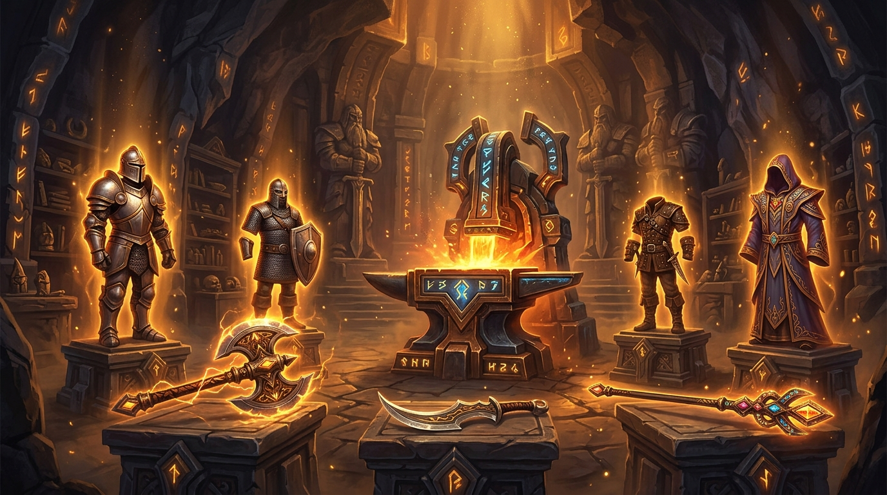

# mod-twow-heirloom



A standalone heirloom equipment module for the community `tortoise-wow` custom vMaNGOS-derived server and its Turtle WoW-compatible client. This is a community project, not an official Turtle WoW module.

> **Bundled & Standalone:** The full item catalog of 9,720 level 1–60 templates across 162 archetypes is bundled directly in `data/sql/world/0001_custom_heirloom_items.sql`. Dual-vendor curators (Curator of Antiquities for armor & jewelry, Master of Weapons for weapons, ranged, and shields) in Stormwind Bank and Orgrimmar Bank are bundled in `data/sql/world/0002_heirloom_vendor_npc.sql`. With `Heirloom.Database.AutoImport = 1` (default), the module automatically verifies the world database and imports missing migrations on world startup seamlessly without requiring manual SQL imports or server restarts.

## Features

- **Level-aware stat scaling:** 9,720 distinct level-specific item prototypes (levels 1–60) for 162 unique heirloom pieces. Primary attributes, stamina, intellect, armor, attack power, spell damage, healing, and weapon damage naturally scale with every level gained.
- **Dynamic Vendor Inventory:** When talking to an heirloom curator, the vendor window dynamically detects the player's level (1–60) and presents the exact level-appropriate gear for purchase (0 copper / 100% free).
- **Automatic Inventory & Equipment Adaptation:** As a player levels up or logs in, any heirloom items in equipment slots, backpack, or inventory bags automatically adapt to match the player's new character level.
- **Authentic Role Archetypes (No Suffixes):** Items feature evocative classic naming instead of meta role tags:
  - **Guardian** (Tank): Maximized Stamina, Strength/Agility, Defense, and Armor.
  - **Blessed** (Healer): Maximized Intellect, Spirit, and Healing/Spell Power.
  - **Vindicator** (DPS): Maximized Attack Power, Strength/Agility, Critical Strike, or Spell Damage.
  - **Arcane** (Cloth / Caster): Specialized Spell Damage and Intellect/Stamina (replacing Tank for Cloth armor, Staves, Wands, and Off-Hands).
  - All items feature evocative double-quoted lore descriptions. Staves, Wands, and Caster Off-Hands provide scaling Spell Power or Healing instead of Attack Power or Defense.
- **Standard Authentic WoW Armor Invariants:** Plate is Plate (level 40+ requirement), Mail is Mail (level 1+), Leather is Leather, and Cloth is Cloth. No artificial armor morphing or cross-armor type shifting; gear behaves cleanly according to standard World of Warcraft class proficiencies.
- **Configurable bonus XP:** Shoulder **10%**, chest **10%**, ring **5% each**, trinket **0% each** by default (totaling **+30%** bonus XP with standard full set). The bonus is evaluated by equipment slot on the `OnGiveXP` hook, and the final effective percentage is capped at 200%. Weapon heirlooms do not contribute bonus XP.
- **Durability Maintenance:** Equipped heirlooms are immune to durability decay or automatically maintained at full repair.
- **Capital City Dual Vendors:**
  - **Stormwind Bank (Alliance)**: `Kaelen Dawnbrow` (Armor & Jewelry) and `Branden Stormforged` (Weapons & Shields). Faction `12` (Stormwind).
  - **Orgrimmar Bank (Horde)**: `Krag'jin` (Armor & Jewelry) and `Gorrok Warsong` (Weapons & Shields). Faction `29` (Orgrimmar).
  - Configured with `npc_flags = 5` (`UNIT_NPC_FLAG_GOSSIP | UNIT_NPC_FLAG_VENDOR`) for seamless interaction.
- **Bot-compatible hook design:** Uses clean player/session hooks rather than invasive dependencies on TortoiseBots internals.

---

## Catalog & Vendor Overview

The heirloom armory consists of **162** distinct archetypes spanning 60 levels (9,720 templates in `0001_custom_heirloom_items.sql`):
- **111 Armor & Jewelry pieces** sold by the **Curator of Antiquities**:
  - Field Plate Armor (8 slots × 3 roles = 24 items)
  - Banded Mail Armor (8 slots × 3 roles = 24 items)
  - Blackened Defias Leather Armor (8 slots × 3 roles = 24 items)
  - Mystic's Cloth Armor (8 slots × 3 roles = 24 items)
  - Cloaks, Rings, and Trinkets (5 slots × 3 roles = 15 items)
- **51 Weapons, Ranged & Off-Hands** sold by the **Master of Weapons**:
  - 1H Swords, 2H Swords, 1H Axes, 2H Axes, 1H Maces, 2H Maces
  - Daggers, Fist Weapons, Polearms, Staves
  - Bows, Guns, Crossbows, Wands, Thrown Weapons
  - Shields and Caster Off-Hands (17 categories × 3 roles = 51 items)

Each family uses a base entry divisible by 100. The item template for a character of level `L` is:
```text
Item Entry = FamilyBase + clamp(characterLevel, 1, 60)
```
For example, the Vindicator Banded Helm (Mail DPS) has base `904000`:
- Level 1: `904001`
- Level 20: `904020`
- Level 60: `904060`

For full item lists and command references, see [Heirloom Armory Guide](docs/HEIRLOOM_GUIDE.md).

---

## Configuration

The configuration file is located at `Server/etc/modules/mod-twow-heirloom.conf` (template at `conf/mod-twow-heirloom.conf.dist`):

| Key | Default | Description |
| :--- | :--- | :--- |
| `Heirloom.Enable` | `1` | Master feature switch |
| `Heirloom.Scaling.Enable` | `1` | Level-aware stat and prototype scaling |
| `Heirloom.Scaling.MaxLevel` | `60` | Effective character level cap (1–60) |
| `Heirloom.Scaling.StatMultiplier` | `1.0` | Scaling modifier (0.1–10.0) |
| `Heirloom.BonusXP.Enable` | `1` | Bonus experience gain toggle |
| `Heirloom.BonusXP.Rate` | `1.0` | Global XP multiplier |
| `Heirloom.BonusXP.ShoulderPercent` | `10.0` | Bonus XP on shoulder slot (+10%) |
| `Heirloom.BonusXP.ChestPercent` | `10.0` | Bonus XP on chest slot (+10%) |
| `Heirloom.BonusXP.RingPercent` | `5.0` | Bonus XP per ring slot (+5% each) |
| `Heirloom.BonusXP.TrinketPercent` | `0.0` | Bonus XP per trinket slot |
| `Heirloom.Durability.Exempt` | `1` | Durability loss exemption |
| `Heirloom.Announce.Enable` | `1` | In-game announcements on adaptation/XP |
| `Heirloom.Debug.Enable` | `1` | Verbose diagnostic logging in `mangosd` |
| `Heirloom.Database.AutoImport` | `1` | Automatically import missing SQL files on world server boot |
| `Heirloom.Database.SqlPath` | `""` | Optional override path to `data/sql/world/` migration files |

---

## Installation & Setup

1. Place `mod-twow-heirloom` inside `Source/tortoise-wow/modules/`.
2. Generate CMake build files:
   ```powershell
   cmake -B build -S Source/tortoise-wow
   ```
3. Compile the world server (`mangosd.exe`).
4. **Database Migrations**:
   - `0001_custom_heirloom_items.sql` (9,720 templates for all 162 items across 60 levels)
   - `0002_heirloom_vendor_npc.sql` (Stormwind Bank and Orgrimmar Bank dual curators)
   - *With `Heirloom.Database.AutoImport = 1`, migrations import automatically on startup!*
5. Deploy `conf/mod-twow-heirloom.conf.dist` to `Server/etc/modules/mod-twow-heirloom.conf`.
6. Start the server.

---

## Troubleshooting

- **"That vendor doesn't like you":**
  - Verify `npc_flags = 5` in `creature_template`. In Classic/vMaNGOS, vendor flag is `4` and gossip is `1` (`1 | 4 = 5`).
  - Verify vendor factions: Stormwind curators use faction `12` (friendly to Alliance); Orgrimmar curators use faction `29` (friendly to Horde).
- **Items appear white or missing stats:**
  - Close the WoW client and delete the `WDB` cache directory (`WDB/itemcache.wdb`) to refresh client-side template definitions.
- **Items do not scale on level up:**
  - Ensure `Heirloom.Enable = 1` and `Heirloom.Scaling.Enable = 1` in `mod-twow-heirloom.conf`.
- **Vanilla items vs Heirloom items:**
  - `0001_custom_heirloom_items.sql` contains exclusively custom heirloom items (`900001`–`916160`). Default vanilla items (such as *Onyxia Blood Talisman* `18406` or *Beastmaster's Mantle* `22016`) are part of the standard `tw_world` database and are not altered.

---

## Documentation Links

- [Complete Heirloom Armory & Quick-Reference Guide](docs/HEIRLOOM_GUIDE.md)
- [Technical Architecture & Hook Specification](docs/ARCHITECTURE.md)
